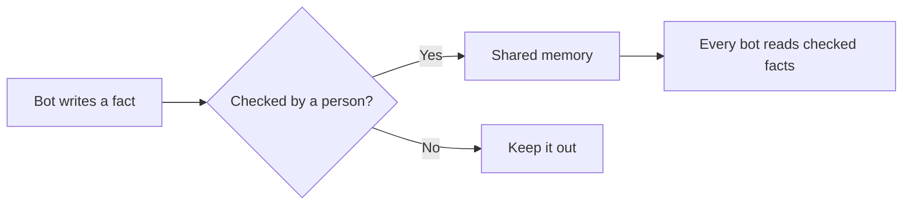

# Memory the bots share

Each example has two bots ask for a dose, one after the other. The bots save facts in shared memory. The first bot may use a model that makes up a dose, with --model invent. Pick the first doctor with --hcp and the second with --then.

## The story in one picture



## The problem

One bot saves a wrong dose. Every bot after it reads the fact and repeats it. The shared memory is now poisoned.

## New words

Each word has one meaning in every lab.

- **shared memory**: Facts that every bot can read.
- **poisoned**: Said of memory that holds a wrong fact that got in.
- **provenance**: Where a fact came from: who saved it, and from which source.

## Run it

Copy any line into your terminal. Each one is a real example from this lab.

```bash
bun run lab shared-memory --question "What is the dose of Cardioza for Dr. Lee?" --hcp dr-lee --model invent --naive
bun run lab shared-memory --question "What is the dose of Cardioza for Dr. Lee?" --hcp dr-lee
bun run lab shared-memory --question "What is the dose of Cardioza for Dr. Lee?" --hcp dr-lee --model invent
bun run lab shared-memory --question "What is the dose of Cardioza for Dr. Weber?" --hcp dr-lee --then dr-weber
bun run lab shared-memory --question "What is the dose of Zorbex for Dr. Lee?" --hcp dr-lee
bun run lab shared-memory --demo
```

Run `bun run lab shared-memory` with nothing else to pick an example from a menu.

## The cases

Case 1 is the naive way. Read what goes wrong, then read the rest.

| # | Case | Why it matters | Result | Run it alone |
| --- | --- | --- | --- | --- |
| 1 | NAIVE: save whatever a bot says | The first bot makes up a dose and it is saved. The second bot reads it and repeats it. | poisoned | `bun run lab shared-memory --question "What is the dose of Cardioza for Dr. Lee?" --hcp dr-lee --model invent --naive` |
| 2 | The second bot reuses a checked fact | The first bot saves a checked dose. The second bot reads it from memory. | shared | `bun run lab shared-memory --question "What is the dose of Cardioza for Dr. Lee?" --hcp dr-lee` |
| 3 | EDGE: a made-up dose is not saved | The first bot makes up a dose. The check refuses to save it, so the second bot finds the real one. | clean | `bun run lab shared-memory --question "What is the dose of Cardioza for Dr. Lee?" --hcp dr-lee --model invent` |
| 4 | EDGE: a fact for another country | Dr. Lee is in the US and Dr. Weber is in Germany. The US fact is not used for Dr. Weber. | clean | `bun run lab shared-memory --question "What is the dose of Cardioza for Dr. Weber?" --hcp dr-lee --then dr-weber` |
| 5 | EDGE: no approved document | There is no approved document for Zorbex. Nothing is saved, and the second bot says so too. | no-answer | `bun run lab shared-memory --question "What is the dose of Zorbex for Dr. Lee?" --hcp dr-lee` |

## Stuck points

**Correct run:** Save a fact only when it passes the dose check. Each fact keeps the source it came from.

**Common wrong turn:** Saving whatever a bot says. The next bot reads the wrong dose and repeats it.

**Hint to give:** Who checked this fact, and where did it come from?

| What you see | What it means | Fix |
| --- | --- | --- |
| The demo prints outcome: poisoned on the NAIVE case | A made-up dose was saved and reused | Check each fact before it is saved |
| A fact is not saved | It failed the dose check | This is correct. Ask the approved source again |
| A saved fact has no source | The writer did not record the source | Save the source with every fact |

## The promise, and its test

A fact is saved only if it passes the dose check. Each fact keeps its provenance, which is the source it came from.

```bash
bun test tests/promises/34.test.ts
```

To see the test do its job, break the rule in PART 1 on purpose. The test must fail. Then undo it.

## In production

Keep memory in a database with the writer and the source on every row. Let a person delete a poisoned fact, and log every read.

## Read the code

Open `labs/34-shared-memory.ts`. Read the code from the top. It holds only the lesson.
The screen output is in `show/`. You do not need it to learn.
