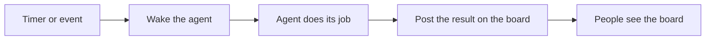

# Wake the bot and show its work

Each example wakes a bot. Give the hours of each wakeup with --times. Give webhook ids with --events, and send the same id twice to see a repeat. Each slot runs its job once. Add --fail true to make the model fail.

## The story in one picture



## The problem

A bot that wakes by itself can run twice, and nobody sees it. A tick repeats, or a webhook arrives twice, and the work is done again.

## New words

Each word has one meaning in every lab.

- **wakeup**: A moment when a bot starts on its own, from a timer or an event.
- **slot**: One fixed period of time, such as one day, that a job runs in once.
- **board**: A list of cards, one for each run, that shows what each agent did.
- **idempotent**: Safe to run twice, with the same result as running once.

## Run it

Copy any line into your terminal. Each one is a real example from this lab.

```bash
bun run lab wakeups-and-board --question "Check the Cardioza dose for Dr. Lee every day." --times '0,5' --naive
bun run lab wakeups-and-board --question "Check the Cardioza dose for Dr. Lee every day." --times '0,5,25'
bun run lab wakeups-and-board --demo
bun run lab wakeups-and-board --question "Check the Cardioza dose for Dr. Lee every day." --times 0 --fail
bun run lab wakeups-and-board --demo
```

Run `bun run lab wakeups-and-board` with nothing else to pick an example from a menu.

## The cases

Case 1 is the naive way. Read what goes wrong, then read the rest.

| # | Case | Why it matters | Result | Run it alone |
| --- | --- | --- | --- | --- |
| 1 | NAIVE: every wakeup runs | The bot wakes at hour 0 and again at hour 5, which is the same day. It does the day's work twice. | duplicates | `bun run lab wakeups-and-board --question "Check the Cardioza dose for Dr. Lee every day." --times '0,5' --naive` |
| 2 | One run for each day | Hours 0 and 5 are one day, and hour 25 is the next. The board has two cards. | once | `bun run lab wakeups-and-board --question "Check the Cardioza dose for Dr. Lee every day." --times '0,5,25'` |
| 3 | A webhook arrives twice | The same label event is delivered two times. The second delivery is ignored. | once | `bun run lab wakeups-and-board --demo` |
| 4 | EDGE: the model fails | The model is down. The board shows a failed card, so a person can see it. | failed | `bun run lab wakeups-and-board --question "Check the Cardioza dose for Dr. Lee every day." --times 0 --fail` |

## The promise, and its test

A key runs once, so the job is idempotent. Every run is a card on the board, and a failed run is a card that says failed.

```bash
bun test tests/promises/35.test.ts
```

To see the test do its job, break the rule in PART 1 on purpose. The test must fail. Then undo it.

## In production

Use your scheduler or a queue, and keep the keys in a database. Alert a person when a card says failed, or says running for too long.

## Read the code

Open `labs/35-wakeups-and-board.ts`. Read the code from the top. It holds only the lesson.
The screen output is in `show/`. You do not need it to learn.
