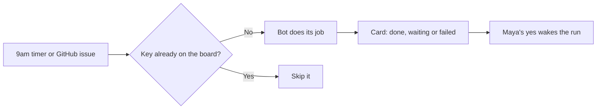

# Wake the bot and show its work

Each example wakes a bot. Give the hours of each wakeup with --times, where hour 0 is Monday 9am. Give webhook ids with --events, and send the same id twice to see a repeat. Add --approval true for a draft that needs Maya, and --approve with the hour of her yes. Add --fail true to make the model fail.

## The story in one picture



## The problem

A bot that wakes by itself can run twice, and nobody sees it. A tick repeats, or a webhook arrives twice, and the work is done again. A bot that waits for Maya all day is stuck.

## New words

Each word has one meaning in every lab.

- **wakeup**: A moment when a bot starts on its own, from a timer or an event.
- **slot**: One fixed period of time, such as one day, that a job runs in once.
- **board**: A list of cards, one for each run, that shows what each agent did.
- **idempotent**: Safe to run twice, with the same result as running once.

## Run it

Copy any line into your terminal. Each one is a real example from this lab.

```bash
bun run lab wakeups-and-board --question "Sweep the inbox every weekday at 9am." --times '0,1' --naive
bun run lab wakeups-and-board --question "Sweep the inbox every weekday at 9am." --times '0,1,24'
bun run lab wakeups-and-board --question "Triage issue-103 when GitHub posts it." --events 'delivery-9001,delivery-9001'
bun run lab wakeups-and-board --question "Draft the reply to the Acme contract mail." --times 0 --approval --hold
bun run lab wakeups-and-board --question "Draft the reply to the Acme contract mail." --times 0 --approval --approve 24
bun run lab wakeups-and-board --question "Draft the reply to the Acme contract mail." --times 0 --approval --approve '24,25'
bun run lab wakeups-and-board --question "Sweep the inbox every weekday at 9am." --times 0 --fail
bun run lab wakeups-and-board --demo
```

Run `bun run lab wakeups-and-board` with nothing else to pick an example from a menu.

## The cases

Case 1 is the naive way. Read what goes wrong, then read the rest.

| # | Case | Why it matters | Result | Run it alone |
| --- | --- | --- | --- | --- |
| 1 | NAIVE: every wakeup runs | The bot wakes at 9am and again at 10am on Monday. It sweeps the same inbox twice. | duplicates | `bun run lab wakeups-and-board --question "Sweep the inbox every weekday at 9am." --times '0,1' --naive` |
| 2 | One sweep for each day | Hours 0 and 1 are Monday, and hour 24 is Tuesday. The board has two cards. | once | `bun run lab wakeups-and-board --question "Sweep the inbox every weekday at 9am." --times '0,1,24'` |
| 3 | A webhook arrives twice | GitHub delivers the same issue event two times. The second delivery is ignored. | once | `bun run lab wakeups-and-board --question "Triage issue-103 when GitHub posts it." --events 'delivery-9001,delivery-9001'` |
| 4 | NAIVE: a worker waits for Maya | The worker waits inside the run for her yes. Its card says running all day. | blocked | `bun run lab wakeups-and-board --question "Draft the reply to the Acme contract mail." --times 0 --approval --hold` |
| 5 | Maya says yes a day later | The draft waits as a card. Her yes on Tuesday wakes the run, and it sends the draft. | resumed | `bun run lab wakeups-and-board --question "Draft the reply to the Acme contract mail." --times 0 --approval --approve 24` |
| 6 | EDGE: Maya clicks yes twice | The second click has its own key and is ignored, so the draft goes out once. | resumed | `bun run lab wakeups-and-board --question "Draft the reply to the Acme contract mail." --times 0 --approval --approve '24,25'` |
| 7 | EDGE: the model fails | The model is down. The board shows a failed card, so Maya can see it. | failed | `bun run lab wakeups-and-board --question "Sweep the inbox every weekday at 9am." --times 0 --fail` |

## Stuck points

**Correct run:** Run each job once per slot, using its key. Every run appears on the board as a card.

**Common wrong turn:** Letting every wakeup run. A wakeup at 9am and again at 10am does the sweep twice.

**Hint to give:** Which key would show that this slot already ran?

| What you see | What it means | Fix |
| --- | --- | --- |
| The demo prints outcome: duplicates on the NAIVE case | The job ran twice in one day | Make each slot one key, and run a key only once |
| A card says failed | The run failed | Read the card. Fix the cause, then wake the bot again |
| A webhook is skipped | Its id was seen before | This is correct. A repeat is safe to skip |
| A card says running all day | A worker waits inside the run for Maya | Save the draft as waiting, and stop |

## The promise, and its test

A key runs once, so the job is idempotent. A draft waits as a card, not as a worker. Maya's yes wakes it from its log. A failed run is a card that says failed.

```bash
bun test tests/promises/35.test.ts
```

To see the test do its job, break the rule in PART 1 on purpose. The test must fail. Then undo it.

## In production

Use your scheduler or a queue, and keep the keys in a database. Alert Maya when a card says failed, or waits too long.

## Read the code

Open `labs/35-wakeups-and-board.ts`. Read the code from the top. It holds only the lesson.
The screen output is in `show/`. You do not need it to learn.
