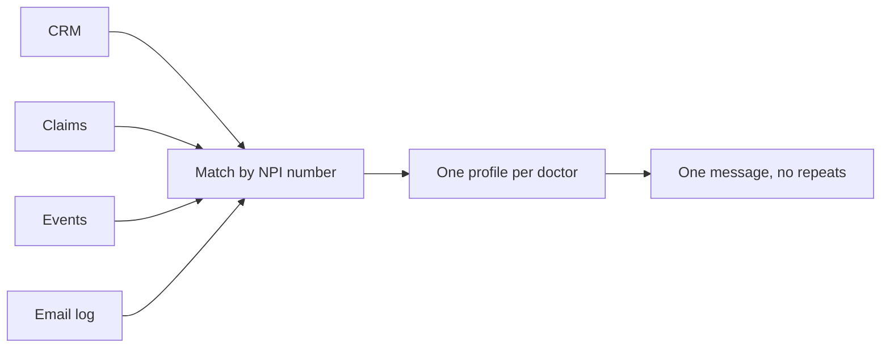

# One profile for each doctor

Each example asks to email one doctor. Pick the doctor with --npi, the NPI that belongs to that doctor. The bot merges four systems, then decides if the email may go.

## The story in one picture



## The problem

Each system sees only its own piece. The email system shows nothing recent, so the doctor gets a second message after a medical question.

## New words

Each word has one meaning in every lab.

- **NPI**: A 10-digit number that names one doctor.
- **merge**: Join pieces from several sources into one result.
- **opt-out**: The doctor asked us not to send emails.
- **quiet days**: Days we wait after a contact before we write.

## Run it

Copy any line into your terminal. Each one is a real example from this lab.

```bash
bun run lab hcp-360 --question "Please email Dr. Lee the new Dermalin label." --npi 1000000004 --naive
bun run lab hcp-360 --question "Please email Dr. Lee the new Dermalin label." --npi 1000000004
bun run lab hcp-360 --question "Please email Dr. Weber the new Cardioza label." --npi 1000000002
bun run lab hcp-360 --question "Please email Dr. Lee the new Cardioza label." --npi 1000000001
bun run lab hcp-360 --question "Please email Dr. Rao the new Neurovex label." --npi 1000000003
bun run lab hcp-360 --question "Please email Dr. Okafor the new Dermalin label." --npi 1000000005
bun run lab hcp-360 --demo
```

Run `bun run lab hcp-360` with nothing else to pick an example from a menu.

## The cases

Case 1 is the naive way. Read what goes wrong, then read the rest.

| # | Case | Why it matters | Result | Run it alone |
| --- | --- | --- | --- | --- |
| 1 | NAIVE: read the email system only | Dr. Lee asked the medical team a question two days ago. The email system shows nothing, so the naive bot sends. | spam | `bun run lab hcp-360 --question "Please email Dr. Lee the new Dermalin label." --npi 1000000004 --naive` |
| 2 | Contact from another system | The same request, with all four systems merged. The question two days ago blocks the email. | blocked | `bun run lab hcp-360 --question "Please email Dr. Lee the new Dermalin label." --npi 1000000004` |
| 3 | Nothing recent | Dr. Weber was last contacted 12 days ago. The email is written from the approved German label. | sent | `bun run lab hcp-360 --question "Please email Dr. Weber the new Cardioza label." --npi 1000000002` |
| 4 | A recent email | Dr. Lee got a Cardioza email 3 days ago. We wait. | blocked | `bun run lab hcp-360 --question "Please email Dr. Lee the new Cardioza label." --npi 1000000001` |
| 5 | EDGE: the doctor opted out | Dr. Rao said no emails. This rule beats every other. | blocked | `bun run lab hcp-360 --question "Please email Dr. Rao the new Neurovex label." --npi 1000000003` |
| 6 | EDGE: a row with no NPI | A booth visit has a name but no NPI. It may be Dr. Okafor. A person must look, so the email is held. | held | `bun run lab hcp-360 --question "Please email Dr. Okafor the new Dermalin label." --npi 1000000005` |

## The promise, and its test

One profile joins all four systems by NPI. An opt-out blocks the email. So does a contact inside the quiet days, which is 7 days here. A row with no NPI is never guessed.

```bash
bun test tests/promises/36.test.ts
```

To see the test do its job, break the rule in PART 1 on purpose. The test must fail. Then undo it.

## In production

Keep the profile in your CRM. Clean the NPI at the door, and let a person review each held row.

## Read the code

Open `labs/36-hcp-360.ts`. Read the code from the top. It holds only the lesson.
The screen output is in `show/`. You do not need it to learn.
