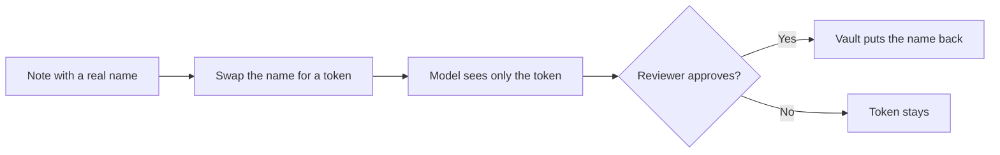

# Private data in a vault

Each example saves a case record for a doctor's note. Pick who looks at it with --role: reviewer or agent. The model never reads the real private data.

## The story in one picture



## The problem

A fixed mask hides the data from the model, but it also hides it from the reviewer. Nobody can get the value back.

## New words

token = a stand-in such as [SSN-1]. vault = the place that keeps the real values. role = what a person is allowed to do. audit = a file that lists every try.

## Run it

Copy any line into your terminal. Each one is a real example from this lab.

```bash
bun run lab phi-vault --demo
bun run lab phi-vault --demo
bun run lab phi-vault --demo
bun run lab phi-vault --demo
bun run lab phi-vault --demo
```

Run `bun run lab phi-vault` with nothing else to pick an example from a menu.

## The cases

Case 1 is the naive way. Read what goes wrong, then read the rest.

| # | Case | Why it matters | Result | Run it alone |
| --- | --- | --- | --- | --- |
| 1 | NAIVE: a fixed mask | The reviewer opens the record. It says [SSN], and the real number is gone for good. | lost | `bun run lab phi-vault --demo` |
| 2 | A reviewer opens the record | The model read [SSN-1]. The reviewer sees the real number, and the audit file has one line. | revealed | `bun run lab phi-vault --demo` |
| 3 | An agent opens the record | An agent is not a reviewer. The record keeps its tokens, and the refused try is in the audit file. | hidden | `bun run lab phi-vault --demo` |
| 4 | EDGE: the same number twice | The SSN is in the note two times. Both get [SSN-1], and the phone gets its own token. | hidden | `bun run lab phi-vault --demo` |

## The promise, and its test

The model sees tokens only. The same value has the same token. Only a reviewer sees real values, and every try is in the audit file.

```bash
bun test tests/promises/37.test.ts
```

To see the test do its job, break the rule in PART 1 on purpose. The test must fail. Then undo it.

## In production

Keep the vault in an encrypted store with its own access list. Let your identity system say who is a reviewer. Never log the real values.

## Read the code

Open `labs/37-phi-vault.ts`. Read the code from the top. It holds only the lesson.
The screen output is in `show/`. You do not need it to learn.
