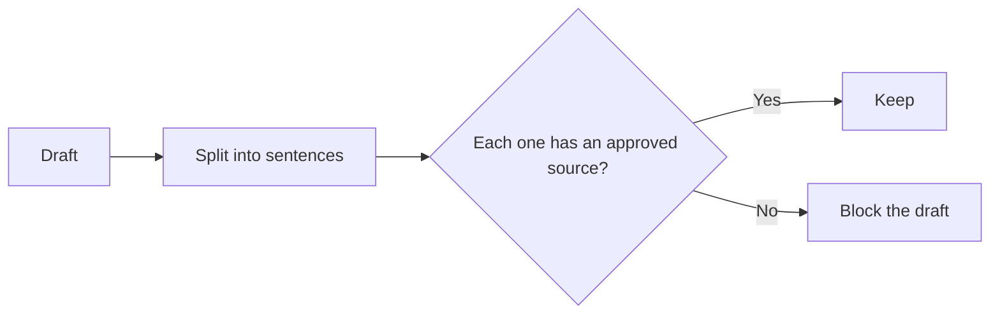

# Check every sentence of a draft

Each example is an email draft that a person wrote. Code checks each sentence. A claim needs a citation, such as [DOC-101], and the document's own words, word for word. Give the draft with --draft, and the doctor's country with --country.

## The story in one picture



## The problem

A draft can cite a real document and still say something that document never says. A model that reviews its own draft has no new facts.

## New words

Each word has one meaning in every lab.

- **claim**: A sentence that says something about a drug, such as its dose.
- **citation**: A document id in brackets, such as [DOC-101], that names the source.
- **word for word**: The same words as the source, with nothing changed.

## Run it

Copy any line into your terminal. Each one is a real example from this lab.

```bash
bun run lab fact-checker --demo
bun run lab fact-checker --demo
bun run lab fact-checker --demo
bun run lab fact-checker --demo
bun run lab fact-checker --demo
bun run lab fact-checker --demo
```

Run `bun run lab fact-checker` with nothing else to pick an example from a menu.

## The cases

Case 1 is the naive way. Read what goes wrong, then read the rest.

| # | Case | Why it matters | Result | Run it alone |
| --- | --- | --- | --- | --- |
| 1 | NAIVE: ask the model if it is fine | The draft says Cardioza is safe for children. The document says nothing like that. The model has no new facts, so it says the draft is fine. | self-approved | `bun run lab fact-checker --demo` |
| 2 | Every sentence is checked | The same draft goes to the claim checker. The sentence about children is not in DOC-101, so the email is blocked. | blocked | `bun run lab fact-checker --demo` |
| 3 | A good draft | The dose sentence is word for word in DOC-101. The other two are plain talk. | sent | `bun run lab fact-checker --demo` |
| 4 | EDGE: the wrong country | Dr. Weber is in Germany. DOC-101 is the US label, so its dose is not for him. | blocked | `bun run lab fact-checker --demo` |
| 5 | EDGE: only the last sentence is bad | The first sentences are good. The last one is a new claim. It is found, and it is the only one named. | blocked | `bun run lab fact-checker --demo` |

## The promise, and its test

Every sentence is checked. A claim needs a citation, a document for this country, and the document's own words. One bad sentence blocks the email.

```bash
bun test tests/promises/38.test.ts
```

To see the test do its job, break the rule in PART 1 on purpose. The test must fail. Then undo it.

## In production

Use a trained claim finder to catch claims that name no drug. Send each blocked sentence to a medical reviewer, and keep the result in the log.

## Read the code

Open `labs/38-fact-checker.ts`. Read the code from the top. It holds only the lesson.
The screen output is in `show/`. You do not need it to learn.
