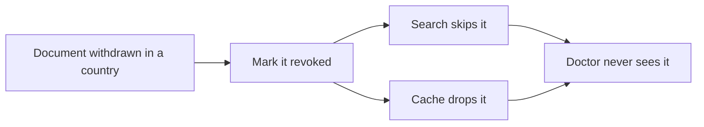

# Withdrawn documents and the cache

Each example asks one question twice. In between, a document may be withdrawn, which means the company took it back. Use --withdraw to withdraw it after the first answer. Use --late to withdraw it while the second answer is made.

## The story in one picture



## The problem

A cache holds saved answers. It is fast, and it never looks at the document again. When the document is withdrawn, the old dose still goes out.

## New words

Each word has one meaning in every lab.

- **withdrawn**: The company took the document back, so no one may use it.
- **cache**: A store of saved answers, so the next ask is faster.
- **revoke**: Make a saved answer stop working in every place.

## Run it

Copy any line into your terminal. Each one is a real example from this lab.

```bash
bun run lab revocation --question "What is the dose of Cardioza for Dr. Lee?" --withdraw CARDIOZA-US --naive
bun run lab revocation --question "What is the dose of Cardioza for Dr. Lee?" --withdraw CARDIOZA-US
bun run lab revocation --question "What is the dose of Cardioza for Dr. Lee?" --withdraw CARDIOZA-DE
bun run lab revocation --question "What is the dose of Cardioza for Dr. Lee?"
bun run lab revocation --question "What is the dose of Cardioza for Dr. Lee?" --late CARDIOZA-US
bun run lab revocation --demo
```

Run `bun run lab revocation` with nothing else to pick an example from a menu.

## The cases

Case 1 is the naive way. Read what goes wrong, then read the rest.

| # | Case | Why it matters | Result | Run it alone |
| --- | --- | --- | --- | --- |
| 1 | NAIVE: serve the saved answer | CARDIOZA-US is withdrawn after the first answer. The saved answer still holds its dose, and it goes out again. | stale | `bun run lab revocation --question "What is the dose of Cardioza for Dr. Lee?" --withdraw CARDIOZA-US --naive` |
| 2 | A withdrawn document | The saved answer cites CARDIOZA-US. It is deleted. Nothing else is approved for Cardioza in the US, so there is no answer. | no-answer | `bun run lab revocation --question "What is the dose of Cardioza for Dr. Lee?" --withdraw CARDIOZA-US` |
| 3 | Another country's document | CARDIOZA-DE is for Germany. It is withdrawn, but Dr. Lee is in the US, so the saved answer is still good. | cache | `bun run lab revocation --question "What is the dose of Cardioza for Dr. Lee?" --withdraw CARDIOZA-DE` |
| 4 | Nothing withdrawn | The second ask is served from the saved answer. It is fast, and it is still approved. | cache | `bun run lab revocation --question "What is the dose of Cardioza for Dr. Lee?"` |
| 5 | EDGE: checked again at the moment of sending | There is no saved answer. The document is withdrawn after the search and before the send. The last check catches it. | blocked | `bun run lab revocation --question "What is the dose of Cardioza for Dr. Lee?" --late CARDIOZA-US` |

## Stuck points

**Correct run:** Check the withdrawal list on every answer, even a saved one. A withdrawn document is never sent.

**Common wrong turn:** Serving the saved answer. The cache never looks at the document again, so the old dose goes out.

**Hint to give:** Does the cache check the withdrawal list before it replies?

| What you see | What it means | Fix |
| --- | --- | --- |
| The demo prints outcome: stale on the NAIVE case | The saved answer went out after withdrawal | Check the withdrawal list on every cached reply |
| The answer is refused after withdrawal | The document is withdrawn now | This is correct. Ask for a current document |
| A US answer reaches a German doctor | The country filter was skipped | Filter by country on every reply, cached or not |

## The promise, and its test

A withdrawn document is never sent, even from the cache. That holds for a saved answer, and for an answer made a moment before. A US answer never reaches a German doctor.

```bash
bun test tests/promises/39.test.ts
```

To see the test do its job, break the rule in PART 1 on purpose. The test must fail. Then undo it.

## In production

Keep the withdrawal list in the same store as the documents. Revoke every saved answer that uses the document. Alert the medical team when a saved answer is dropped.

## Read the code

Open `labs/39-revocation.ts`. Read the code from the top. It holds only the lesson.
The screen output is in `show/`. You do not need it to learn.
