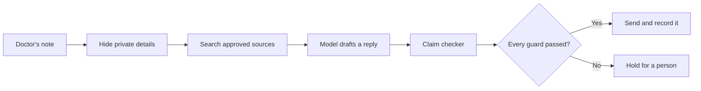

# Put it all together

Each example sends one doctor's note through every guard from the labs before. Use --hcp to pick the doctor. Use --withdraw to withdraw a document first. Use --approve y or n to answer the person's gate.

## The story in one picture



## The problem

Each guard works alone. One missing guard is still a hole. A note can leak a patient. A withdrawn dose can go out. The other guards cannot help.

## New words

guard = one check that stops one risk. record = the log of every step, linked so an edit shows. gate = a stop where a person decides.

## Run it

Copy any line into your terminal. Each one is a real example from this lab.

```bash
bun run lab end-to-end --demo
bun run lab end-to-end --demo
bun run lab end-to-end --question "What is the dose of Cardioza for Dr. Lee?" --model nocite --approve y
bun run lab end-to-end --question "What is the dose of Cardioza for Dr. Lee?" --model nocite --approve n
bun run lab end-to-end --question "What is the dose of Cardioza for Dr. Lee?" --withdraw DOC-101
bun run lab end-to-end --question "What is the dose of Cardioza for Dr. Lee?" --hcp H-9
bun run lab end-to-end --demo
```

Run `bun run lab end-to-end` with nothing else to pick an example from a menu.

## The cases

Case 1 is the naive way. Read what goes wrong, then read the rest.

| # | Case | Why it matters | Result | Run it alone |
| --- | --- | --- | --- | --- |
| 1 | NAIVE: no guards | The model reads the patient's name and number, and its reply goes out with no check. | sent-unchecked | `bun run lab end-to-end --demo` |
| 2 | Every guard passes | The private details are hidden, the reply matches DOC-101, and the record is whole. | sent | `bun run lab end-to-end --demo` |
| 3 | EDGE: a reply with no source, and a person says yes | The model forgets the citation, so the check fails. The person reads it and approves. | sent-after-approval | `bun run lab end-to-end --question "What is the dose of Cardioza for Dr. Lee?" --model nocite --approve y` |
| 4 | EDGE: a reply with no source, and a person says no | The same failure, and the person says no. Nothing is sent. | blocked | `bun run lab end-to-end --question "What is the dose of Cardioza for Dr. Lee?" --model nocite --approve n` |
| 5 | EDGE: the document was withdrawn | DOC-101 is withdrawn, and no other approved document is left. The bot says it has no approved source. That is true, so it goes out. The old dose never does. | sent | `bun run lab end-to-end --question "What is the dose of Cardioza for Dr. Lee?" --withdraw DOC-101` |
| 6 | EDGE: a doctor we do not know | H-9 is not in the CRM, so the run stops at step 1. | refused | `bun run lab end-to-end --question "What is the dose of Cardioza for Dr. Lee?" --hcp H-9` |

## The promise, and its test

Private details never reach the model. Only a checked reply goes out, or one a person approved. Every step is in a record that shows any edit.

```bash
bun test tests/promises/40.test.ts
```

To see the test do its job, break the rule in PART 1 on purpose. The test must fail. Then undo it.

## In production

Run each guard as its own service with its own owner. Alert a person when a guard blocks, and keep the record in storage that cannot be changed.

## Read the code

Open `labs/40-end-to-end.ts`. Read the code from the top. It holds only the lesson.
The screen output is in `show/`. You do not need it to learn.
